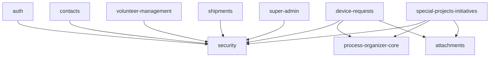
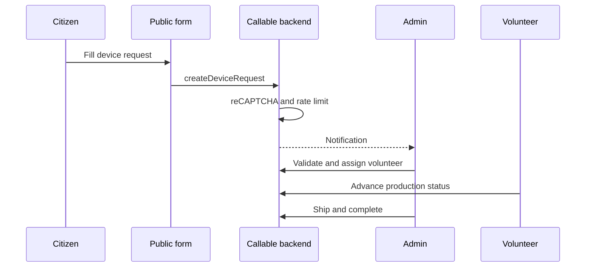

<!-- Generated by codeforge render-docs from doc-plan.json (page_key "arch-overview"): edit only the text between the codeforge:body markers, the rest is regenerated. -->

# Architecture overview

<!-- codeforge:local-only:start -->

Section 3 · Architecture

Parent page: [Architecture](section-3.md)

<!-- codeforge:local-only:end -->

<!-- codeforge:body:start (testo scrivibile: e' la sorgente pubblicata su Confluence) seed:d52f8aa15412ca70 -->
The system is a React single-page application that talks exclusively to Firebase callable functions. Two ideas organise the domains.

**Cross-cutting foundations.** The security module (RBAC, rate limiting, reCAPTCHA, audit log) is not a business domain: it is used by the entry points of authentication, device requests, volunteers, shipments, contacts and, through the shared super-admin gate, by platform operations. Documenting it first explains why every other chapter mentions the same guards.

**Generic modules reused by business domains.** The checklist module (process-organizer-core) and the attachments module are deliberately agnostic of their consumers. Device requests use both; special projects use both through thin wrappers. The workspace records these dependencies explicitly in the relates_to links of the special-projects capabilities, which depend on the checklist lifecycle, the completeness gate and the attachment catalog and RBAC. The reverse direction does not exist: the generic modules know nothing about their consumers.

The diagrams show the dependency structure and the two main end-to-end flows. The identity flow (registration to activation) and the device request flow (public submission to completion) are those documented in the discovery context; the interaction between the contacts form and volunteer invitations is only partially documented: invitations are sent from the contacts list in the volunteer-management area, as stated in the contacts domain summary.

Implementation status per slot is not available because no approved project plan exists; see section 8.

## Domain dependencies

Derivato da: `special-projects-initiatives/cap-project-checklists`, `special-projects-initiatives/cap-project-attachments`, `super-admin/cap-super-admin-gated-operations`, `attachments/uc-attach-file-to-entity`, `discover-context`

## Request and onboarding flows

Derivato da: `discover-context`
<!-- codeforge:body:end -->

**Next:** [Security and Anti-abuse](domain-security.md)
