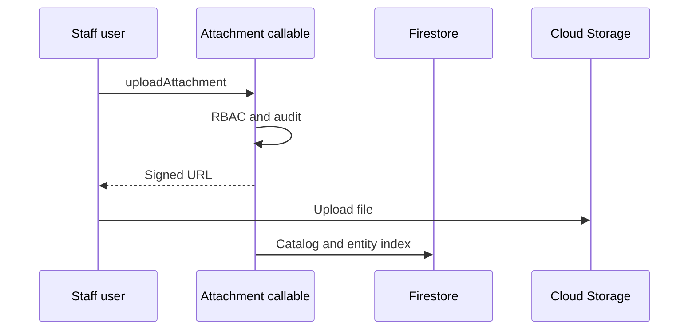

<!-- Generated by codeforge render-docs from doc-plan.json (page_key "domain:attachments"): edit only the text between the codeforge:body markers, the rest is regenerated. -->

# Attachments

<!-- codeforge:local-only:start -->

Section 3 · Architecture

Parent page: [Architecture](section-3.md)

<!-- codeforge:local-only:end -->

<!-- codeforge:body:start (testo scrivibile: e' la sorgente pubblicata su Confluence) seed:b595a985671a987b -->
Attachments is a generic capability for attaching files to higher-level entities, visible to staff only (administrators and volunteers). It stores metadata in two places written atomically, a top-level catalog and an index under the owning entity, and moves file content directly between the client and Cloud Storage through short-lived signed URLs, so file bytes never pass through a Cloud Function. The module does not know its consumers: entity type, id and collection path are opaque parameters, and RBAC is enforced by the callables, with a differentiated rule for owner versus administrator. Only the issue of a signed URL is recorded in the security log.

Device requests and special projects integrate the module through their own thin wrappers. Open operational points (bucket provisioning, the 50 MB size limit that the operator never confirmed) are tracked as findings in the gap register of section 8.

## Upload and download with signed URLs

Derivato da: `attachments/cap-upload-attachment`, `attachments/cap-download-attachment`, `attachments/dc-signed-url`, `attachments/cap-attachment-catalog-model`
<!-- codeforge:body:end -->

**Next:** [Device Requests](domain-device-requests.md)
