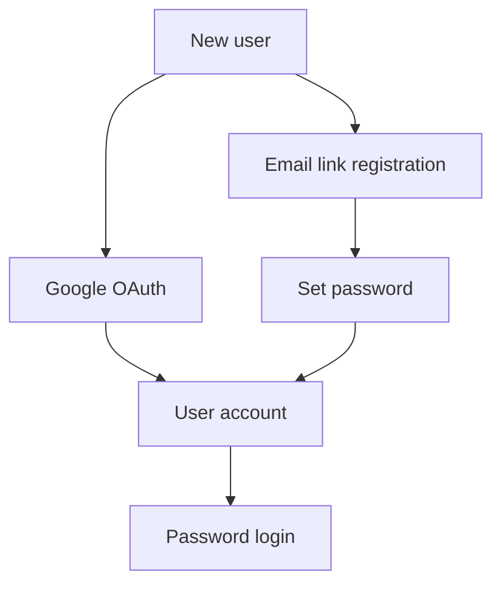

<!-- Generated by codeforge render-docs from doc-plan.json (page_key "domain:auth"): edit only the text between the codeforge:body markers, the rest is regenerated. -->

# Authentication and Registration

<!-- codeforge:local-only:start -->

Section 3 · Architecture

Parent page: [Architecture](section-3.md)

<!-- codeforge:local-only:end -->

<!-- codeforge:body:start (testo scrivibile: e' la sorgente pubblicata su Confluence) seed:de618b844beaa84d -->
Two entry paths converge on the same user model: registration through an email link (a single-use oobCode stored as a pending registration) and sign-in or auto-provisioning through Google OAuth. Setting a password afterwards applies only to the email-link path, and the mustSetPassword flag is what forces it. Password login is the third, returning-user path and writes to the security audit log. The chapter sits right after security because every public entry point of authentication relies on the anti-abuse mechanisms described there, and before volunteer management because a registered user is the precondition of the onboarding flow.

## Authentication paths

Derivato da: `auth/cap-email-link-registration`, `auth/cap-google-oauth-registration`, `auth/cap-set-password`, `auth/cap-password-login`, `auth/dc-must-set-password`
<!-- codeforge:body:end -->

**Next:** [Contacts](domain-contacts.md)
