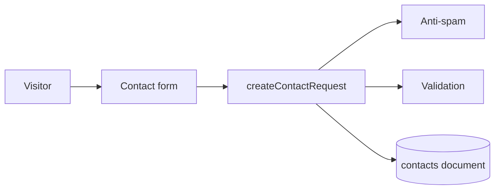

<!-- Generated by codeforge render-docs from doc-plan.json (page_key "domain:contacts"): edit only the text between the codeforge:body markers, the rest is regenerated. -->

# Contacts

<!-- codeforge:local-only:start -->

Section 3 · Architecture

Parent page: [Architecture](section-3.md)

<!-- codeforge:local-only:end -->

<!-- codeforge:body:start (testo scrivibile: e' la sorgente pubblicata su Confluence) seed:69c7524b2a90295e -->
The contacts domain is the public entry point for people who want to get in touch with the association: a form at /contatti, a callable that validates and stores the request, and an anti-spam layer shared with the rest of the platform. Its boundary is deliberately narrow. Administration of contacts (status, invitation to join the community) is not part of this domain: the contacts list lives under the volunteer-management paths, and the domain summary states that no further administrative management is planned. The contact document carries a profile ("who are you") and an origin, which front-end helpers use to present and classify requests.

The workspace does not document how a contact request is notified to administrators; the flow beyond persistence is therefore not described here.

## Contact request flow

Derivato da: `contacts/cap-public-contact-form`, `contacts/cap-create-contact-request`, `contacts/cap-contact-validation`, `contacts/cap-contact-anti-spam`, `contacts/dc-contact-document`
<!-- codeforge:body:end -->

**Next:** [Volunteer Management](domain-volunteer-management.md)
