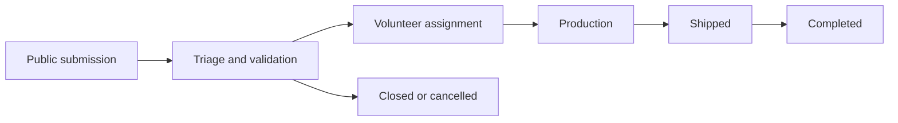

<!-- Generated by codeforge render-docs from doc-plan.json (page_key "domain:device-requests"): edit only the text between the codeforge:body markers, the rest is regenerated. -->

# Device Requests

<!-- codeforge:local-only:start -->

Section 3 · Architecture

Parent page: [Architecture](section-3.md)

<!-- codeforge:local-only:end -->

<!-- codeforge:body:start (testo scrivibile: e' la sorgente pubblicata su Confluence) seed:ae3623e6aa36d744 -->
This is the largest domain of the workspace: the life of a device request from the public submission by a citizen to completion or closure. A request moves through internal statuses that are deliberately distinct from the status shown publicly: a triage phase handled by admins, a production phase handled by the assigned volunteer, and terminal statuses. Admins may move a request between any two statuses, while volunteers have only a small set of allowed transitions. The pages below are split in three groups for navigation: lifecycle and assignment, administrative operations and historical data, and messaging. Later deep-dives added archiving, family consent and documents, operational checklists and attachments; these depend on the generic checklist and attachment modules documented in their own chapters. The per-node pages are in the device-requests reference group of section 9, and the per-slot implementation state is not available because there is no approved plan.

## Request phases

Derivato da: `device-requests/dc-status-lifecycle`, `device-requests/cap-volunteer-assignment`, `device-requests/cap-request-validation`
<!-- codeforge:body:end -->

## Contents

- [Lifecycle and assignment](group-device-requests-lifecycle.md)
- [Administrative operations and historical data](group-device-requests-admin-ops.md)
- [Messaging and email monitoring](group-device-requests-messaging.md)

**Next:** [Shipments](domain-shipments.md)
