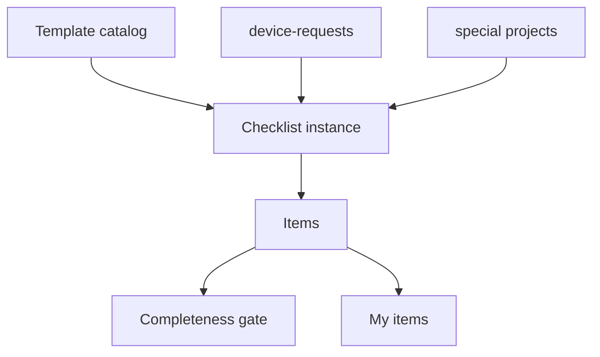

<!-- Generated by codeforge render-docs from doc-plan.json (page_key "domain:process-organizer-core"): edit only the text between the codeforge:body markers, the rest is regenerated. -->

# Process Organizer Core

<!-- codeforge:local-only:start -->

Section 3 · Architecture

Parent page: [Architecture](section-3.md)

<!-- codeforge:local-only:end -->

<!-- codeforge:body:start (testo scrivibile: e' la sorgente pubblicata su Confluence) seed:d4da3c3316fcde7f -->
Process Organizer Core is the generic checklist engine. It owns checklist instances, items with a status and a type, a catalog of reusable templates and a completeness gate. Its design choice is opacity: the category that links a template to a use (for example a device type) is an opaque string, and each checklist keeps a historical reference to the template or source it was created from, so later template edits never rewrite existing instances. The gate reports whether a checklist is complete but never blocks a transition by itself; the consumer decides how to use it, as stated in the checklist lifecycle described in the discovery context.

A cross-consumer aggregation, "My items", lists the items assigned to a user across all checklists, using the checklist origin to tell where each one comes from. Consumers are device requests (production checklists per device type) and special projects (labelled to-do lists). The module is the foundation on which both build their domain-specific wrappers and RBAC.

## Checklist module structure

Derivato da: `process-organizer-core/cap-checklist-template-catalog`, `process-organizer-core/cap-checklist-instance-lifecycle`, `process-organizer-core/cap-checklist-item-management`, `process-organizer-core/cap-completeness-gate`, `process-organizer-core/cap-my-checklist-items`
<!-- codeforge:body:end -->

**Next:** [Attachments](domain-attachments.md)
