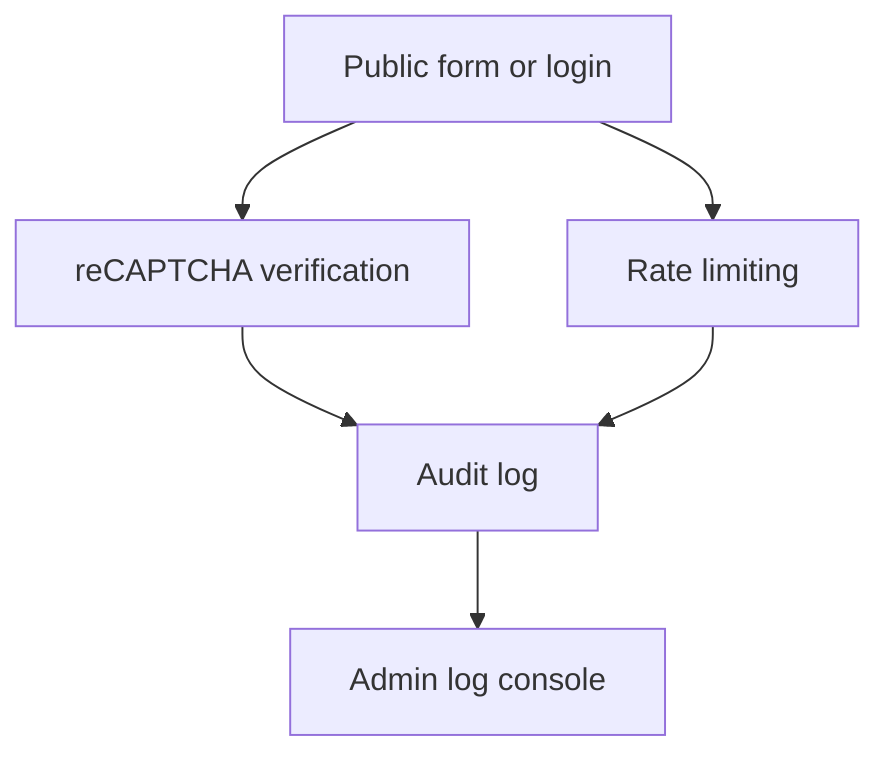

<!-- Generated by codeforge render-docs from doc-plan.json (page_key "domain:security"): edit only the text between the codeforge:body markers, the rest is regenerated. -->

# Security and Anti-abuse

<!-- codeforge:local-only:start -->

Section 3 · Architecture

Parent page: [Architecture](section-3.md)

<!-- codeforge:local-only:end -->

<!-- codeforge:body:start (testo scrivibile: e' la sorgente pubblicata su Confluence) seed:22b34a0e40dd52e0 -->
A cross-cutting module used by the public entry points of authentication and device requests, not a dedicated group of cloud functions. It combines three independent mechanisms: anti-spam (reCAPTCHA verification and rate limiting per email and IP address), the security audit log, and the admin console that exposes the log. It comes first among the chapters because every other domain depends on it.

## Security mechanisms

Derivato da: `security/cap-rate-limiting`, `security/cap-recaptcha-verification`, `security/cap-security-audit-logging`, `security/cap-admin-security-log-console`
<!-- codeforge:body:end -->

**Next:** [Authentication and Registration](domain-auth.md)
