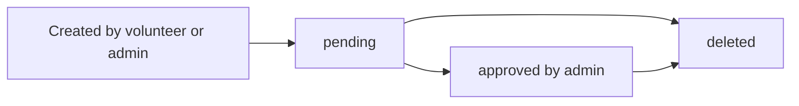

<!-- Generated by codeforge render-docs from doc-plan.json (page_key "domain:shipments"): edit only the text between the codeforge:body markers, the rest is regenerated. -->

# Shipments

<!-- codeforge:local-only:start -->

Section 3 · Architecture

Parent page: [Architecture](section-3.md)

<!-- codeforge:local-only:end -->

<!-- codeforge:body:start (testo scrivibile: e' la sorgente pubblicata su Confluence) seed:a9869baea3847e56 -->
A compact domain, separate from the device request lifecycle: it handles only the physical shipment of parcels, with its own pending, approved and deleted statuses. Volunteers or admins create a request, an admin approves it and an email is queued automatically, and deletion is a soft delete. A known-address suggestion helps filling the form. The domain is kept apart from device requests because a shipment request is not tied to the request status model; no link between the two is documented in the workspace.

## Shipment request statuses

Derivato da: `shipments/cap-shipment-request-lifecycle`
<!-- codeforge:body:end -->

**Next:** [Special Projects and Initiatives](domain-special-projects-initiatives.md)
