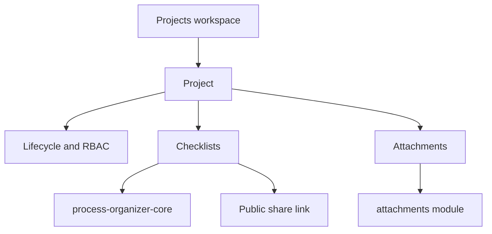

<!-- Generated by codeforge render-docs from doc-plan.json (page_key "domain:special-projects-initiatives"): edit only the text between the codeforge:body markers, the rest is regenerated. -->

# Special Projects and Initiatives

<!-- codeforge:local-only:start -->

Section 3 · Architecture

Parent page: [Architecture](section-3.md)

<!-- codeforge:local-only:end -->

<!-- codeforge:body:start (testo scrivibile: e' la sorgente pubblicata su Confluence) seed:6b6722e6601bbe26 -->
This domain tracks technical projects, initiatives and events as a "project" entity with an extensible type and a five-value status (new, active, standby, archived, closed). Edits are restricted in standby, archived and closed states, creation is admin-only and item assignment is open to volunteers. A project does not implement its own task engine: it holds one or more labelled to-do lists as checklists of the Process Organizer Core, with a public read-only share link for sharing progress with outsiders, and it uses the attachments module for its files. The relates_to links of its capabilities make these dependencies explicit and one-directional.

The design came from the special-projects solution study listed in the decision index of this section.

## Project composition

Derivato da: `special-projects-initiatives/cap-project-crud`, `special-projects-initiatives/cap-project-checklists`, `special-projects-initiatives/cap-project-attachments`, `special-projects-initiatives/cap-project-checklist-public-share`, `special-projects-initiatives/cap-projects-workspace-ui`
<!-- codeforge:body:end -->

**Next:** [Super Admin](domain-super-admin.md)
