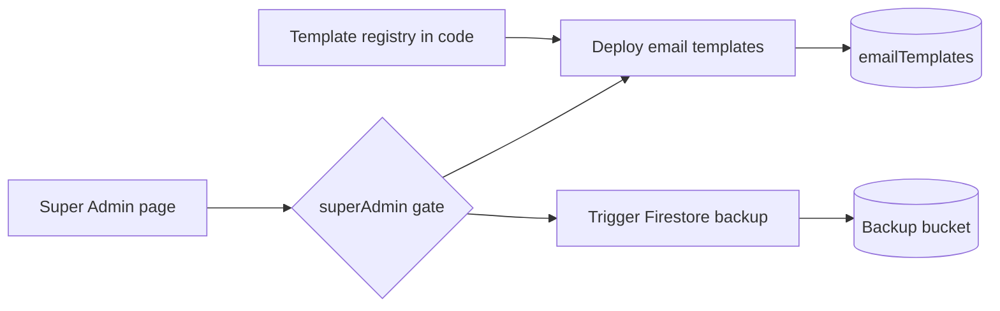

<!-- Generated by codeforge render-docs from doc-plan.json (page_key "domain:super-admin"): edit only the text between the codeforge:body markers, the rest is regenerated. -->

# Super Admin

<!-- codeforge:local-only:start -->

Section 3 · Architecture

Parent page: [Architecture](section-3.md)

<!-- codeforge:local-only:end -->

<!-- codeforge:body:start (testo scrivibile: e' la sorgente pubblicata su Confluence) seed:094e3320a47d4f1f -->
Super Admin groups the platform operations that only a user flagged superAdmin may run: deploying the versioned email template registry to Firestore and triggering a native Firestore export to a dedicated bucket with a 30-day lifecycle. The flag is additive to the admin role and is never a third role value; it is bootstrapped by hand in the Firestore console, and no function writes it on behalf of other users. The shared gate lives in the security module, so this domain contains only the operations and the page that exposes them. The gate is enforced by the backend: the UI page remains reachable by menu or URL for any admin.

Template deployment is forward-only: the registry in code is the source of truth and deployment copies it into the emailTemplates collection.

## Super-admin gated operations

Derivato da: `super-admin/cap-super-admin-gated-operations`, `super-admin/cap-email-template-deploy`, `super-admin/cap-firestore-backup`, `super-admin/cap-super-admin-page`
<!-- codeforge:body:end -->

**Next:** [Functional specifications](../4-specifiche-funzionali/section-4.md)
