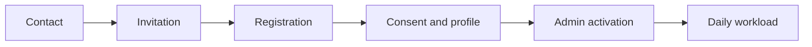

<!-- Generated by codeforge render-docs from doc-plan.json (page_key "domain:volunteer-management"): edit only the text between the codeforge:body markers, the rest is regenerated. -->

# Volunteer Management

<!-- codeforge:local-only:start -->

Section 3 · Architecture

Parent page: [Architecture](section-3.md)

<!-- codeforge:local-only:end -->

<!-- codeforge:body:start (testo scrivibile: e' la sorgente pubblicata su Confluence) seed:23e89bcb4d17ad90 -->
From the first CRM contact to the daily activity of an active volunteer. Three areas are covered: recruiting and activation, the profile and equipment of the volunteer, and the aggregated administrative view. The domain depends on authentication for the account and on the device-requests domain for the work a volunteer carries out, which is why it follows security and authentication and precedes the request-handling chapters. Recent deep-dives added the volunteer requests workspace, the personal to-do list of checklist items and the CSV import of contacts used by admins for maintenance; the to-do list in turn relies on the generic checklist module.

## Volunteer onboarding

Derivato da: `volunteer-management/cap-volunteer-invitation`, `volunteer-management/cap-consent-collection`, `volunteer-management/cap-volunteer-activation`, `volunteer-management/uc-volunteer-manages-workload`
<!-- codeforge:body:end -->

## Contents

- [Recruitment, consent and activation](group-volunteer-management-onboarding.md)
- [Profilo, attrezzatura e attività quotidiana](group-volunteer-management-profile.md)

**Next:** [Process Organizer Core](domain-process-organizer-core.md)
